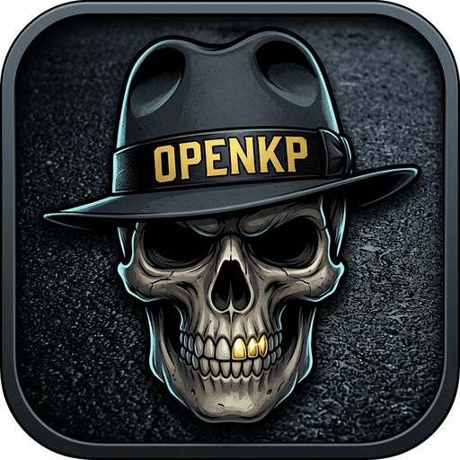

# OpenKP

<p align="center">
  
</p>

<p align="center">
  <b>Modern 64-bit multiplayer client for <i>Kingpin: Life of Crime</i> (1999)</b><br>
  Built on the battle-tested Q2PRO engine foundation.
</p>

<p align="center">
  <a href="https://github.com/OpenKingpin/openkp/actions/workflows/linux.yml?query=branch%3Amain"></a>
  <a href="https://github.com/OpenKingpin/openkp/actions/workflows/windows.yml?query=branch%3Amain"></a>
  <a href="https://github.com/OpenKingpin/openkp/actions/workflows/macos.yml?query=branch%3Amain"></a>
  <a href="https://github.com/OpenKingpin/openkp/actions/workflows/freebsd.yml?query=branch%3Amain"></a>
</p>

---

OpenKP is an unofficial open-source client designed to join existing community servers with modern hardware support, high tickrates, raw mouse input, widescreen scaling, and smooth client-side prediction—with zero server-side friction.

Players bring their own game data. OpenKP does not ship commercial `.pak` files, maps, models, or audio.

---

## Highlights

* **Native 64-Bit:** Full 64-bit binaries for modern Windows and Linux distributions.
* **100% Protocol 32 Wire Compatibility:** Connects directly to existing Kingpin servers on the community's default game port (`31510`).
* **Auto-Detection of Game Data:** Automatically discovers Kingpin installations from Steam, GOG, or custom locations, and prompts with a native folder dialog if not found.
* **In-Game Server Browser:** Queries active Kingpin master servers on UDP `27900` (`master.kingpin.info`, `master0-4.kingpin.info`, `master2.shavargo.com`) with automatic fallback to GitHub server mirror caching.
* **Modern Display & Input:** Native widescreen FOV scaling, high refresh rates (144Hz+), raw mouse input, borderless fullscreen, Wayland, and modern OpenGL rendering.

---

## Testing the Beta

1. **Download:** Grab the latest pre-compiled binary from the GitHub **Releases** or **Actions** tab:
   * Windows: `openkp.exe` (or `openkp64.exe`)
   * Linux: `openkp`
2. **Launch:** Run the executable. 
   * OpenKP will automatically search standard Steam and GOG library locations for your Kingpin `main/` data.
   * If installed elsewhere, a folder dialog will appear asking you to select your Kingpin game folder once.
   * Alternatively, you can drop the executable directly into your Kingpin game directory (next to `main/`).
3. **Connect:** Use the in-game server browser or open the console (`~`) and type:
   ```
   connect <server-ip>:31510
   ```

---

## Building from Source

### Prerequisites
* **Linux (Debian / Ubuntu):**
  ```bash
  sudo apt-get install cmake ninja-build gcc \
      libsdl2-dev libopenal-dev libpng-dev libjpeg-dev zlib1g-dev \
      libcurl4-gnutls-dev libx11-dev libxi-dev libwayland-dev libdecor-0-dev \
      libavcodec-dev libavformat-dev libavutil-dev libswresample-dev libswscale-dev
  ```
* **Linux (Arch):**
  ```bash
  sudo pacman -S cmake ninja gcc sdl2 openal libpng libjpeg-turbo zlib curl libx11 libxi wayland libdecor ffmpeg
  ```
* **Windows (MinGW-w64 via MSYS2 or MSVC):**
  Install CMake, Ninja, and your toolchain.

### Compile with CMake (Recommended)
```bash
# Configure and compile with CMake
cmake -B build -G Ninja
cmake --build build
```

The compiled binary will be placed at:
* Linux: `build/openkp`
* Windows: `build/openkp.exe`

### Compile with Meson
```bash
meson setup builddir -Dbase-game=main -Dsave-games=false
meson compile -C builddir openkp
```

During development, you can point directly to your Kingpin install without moving files:
```bash
./builddir/openkp +set sys_basedir /path/to/Kingpin/
```

---

## Community & Contributing

We welcome developers, modders, and server admins from the **Kingpin.info** community! 

Priority areas where community help is especially appreciated:
* **HUD & Scoreboard Polish:** Bagman team cash balances, stolen money indicators, and ammo positioning.
* **Player Model Tinting:** Multi-part Kingpin character models (head, torso, legs) and team skin color tinting.
* **Movement Prediction Tuning:** Fine-tuning client-side prediction against live servers.
* **Master Server Queries:** Verifying response handling across all active community master servers.

Check out [CONTRIBUTING.md](CONTRIBUTING.md) for how to get involved and submit pull requests.

---

## License & Legal

* **Codebase:** Licensed under the [GNU General Public License v2 (GPLv2)](LICENSE) or any later version, carrying forward the Q2PRO engine license.
* **Trademarks:** *Kingpin*, *Kingpin: Life of Crime*, Interplay, and Xatrix remain the trademarks of their respective owners. This project is an unofficial community client that requires players to supply their own legally purchased game assets.
